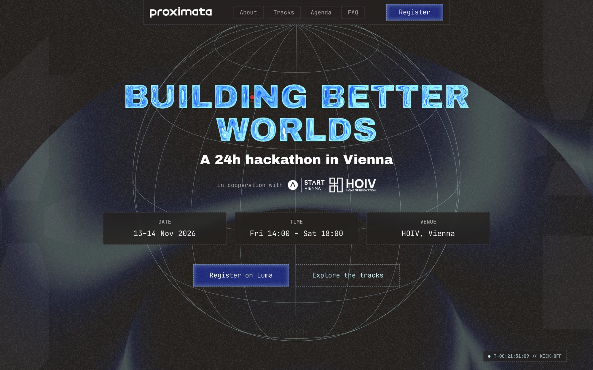

# Building Better Worlds Hackathon

<p>
  <a href="https://proximata.boldhack.at"></a>
  <a href="https://luma.com/rrnm4pul"></a>
  <a href="https://proximata.io"></a>
</p>


<a href="https://proximata.boldhack.at"></a>

**Building Better Worlds** is proximata's flagship 24-hour hackathon in Vienna, organised with
START Vienna and HOIV – Home of InnoVation on 13–14 November 2026 at HOIV, Arsenalstraße 11. This
repo is the event's one-page site: tracks, agenda, partners, prizes and FAQ, with registration on
Luma.

## Quickstart

Requires Node.js 24.

```sh
npm install
npm run dev     # http://localhost:3000
npm run check   # lint, typecheck and production build
```

The site deploys on Vercel; a Dockerfile is included for self-hosting. Commits follow Conventional
Commits, checked by commitlint in a git hook.

## Editing content

All copy and event facts live in typed modules in
[`src/components/sites/proximata/content`](src/components/sites/proximata/content/); the sections
render from them. Mentors, gallery and aftermovie stay hidden until their lists have entries.

| File | Holds |
| :-- | :-- |
| [`event.ts`](src/components/sites/proximata/content/event.ts) | Dates, venue, organisers, Luma link, page description |
| [`agenda.ts`](src/components/sites/proximata/content/agenda.ts) | Sessions per day, each with its time |
| [`tracks.ts`](src/components/sites/proximata/content/tracks.ts) | The four tracks |
| [`prizes.ts`](src/components/sites/proximata/content/prizes.ts) | Winner prizes and what every participant gets |
| [`partners.ts`](src/components/sites/proximata/content/partners.ts) | Sponsors and partners, in display order |
| [`faq.ts`](src/components/sites/proximata/content/faq.ts) | Questions and answers |
| [`metrics.ts`](src/components/sites/proximata/content/metrics.ts) | Key figures, including builders signed up |

The page title and link preview are set in [`src/app/layout.tsx`](src/app/layout.tsx).

## Assets

Images are built from source art by the scripts in [`scripts`](scripts/). Run the Python ones with
`python3 -I scripts/<name>.py`. The organisers' brand book and planning docs go in `brand-book/`,
which is not in git.

| Script | Builds |
| :-- | :-- |
| [`build-partner-logos.py`](scripts/build-partner-logos.py) | Flat white sponsor and partner logos from each organisation's artwork |
| [`build-og-image.py`](scripts/build-og-image.py) | The 1200×630 link-preview card |
| [`build-title-svg.mjs`](scripts/build-title-svg.mjs) | The title outlines for the glass effect (`node scripts/build-title-svg.mjs`) |
| [`build-hands.py`](scripts/build-hands.py) | The Tracks section's "hands touching" picture |
| [`build-about-art.py`](scripts/build-about-art.py) | The About section's Pallas Athene and robot cut-outs |
| [`build-brand-assets.py`](scripts/build-brand-assets.py) | proximata logo stand-ins and app icons from the brand book |
| [`build-mark-paths.py`](scripts/build-mark-paths.py) | The proximata mark as SVG polygons |
| [`recolor-glow.py`](scripts/recolor-glow.py) | The hero glow in the proximata palette |

## Stack

Next.js 16 · React 19 · TypeScript · Tailwind CSS 4 · Motion · Lenis · WebGL · Base UI ·
Archivo Black · JetBrains Mono · Pillow · opentype.js · Vercel

Started from [ai-website-cloner-template](https://github.com/JCodesMore/ai-website-cloner-template)
by JCodesMore (MIT); see [LICENSE](LICENSE). Credits for the About photos are in
[assets/source/about/CREDITS.md](assets/source/about/CREDITS.md).

## Team

<p align="center">
  <a href="https://github.com/julian-at"></a>
</p>
